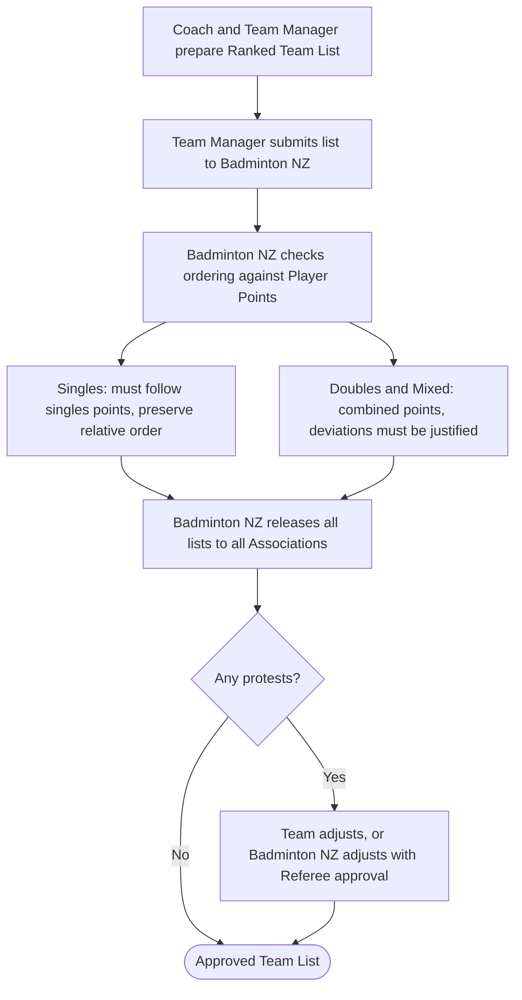
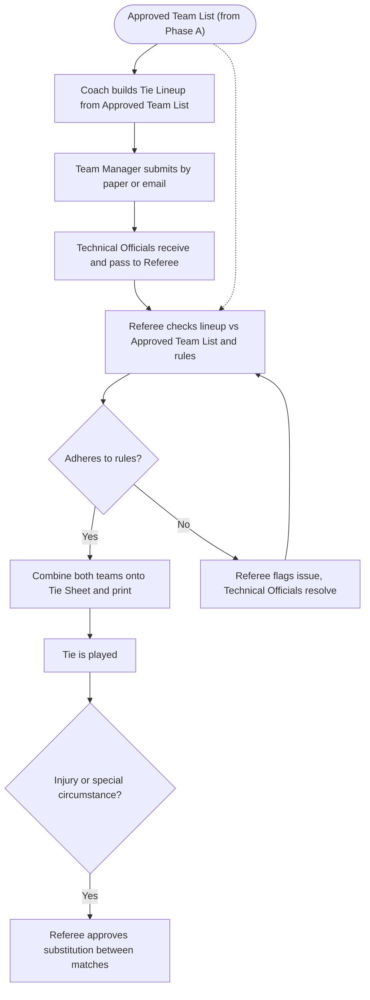

# Badminton New Zealand Team Events: Non-Technical Planning

This document consolidates the two non-technical planning documents into a single source. Part 1 is the Problem Definition (the problem space and the rules the process must enforce). Part 2 is the Requirements (user roles, user stories, and non-functional requirements). Content that appeared in both source documents is kept once, in the section whose job it is to own it, and referenced from the other.

Author: Vincent Tao.

## Versioning

| Date | Author | Rationale |
| --- | --- | --- |
| 21 September 2026 | Vincent Tao | Problem Definition initial draft. |
| 22 September 2026 | Vincent Tao | Requirements initial draft. |
| 24 October 2026 | Vincent Tao | Rescoped around the Phase B first release. Added the unpredictable-draw characteristic; reorganised the requirements into 12 phase-grouped epics; removed the Tie Sheet and substitution stories; added round slots, access details, the seed, and the review-and-copy; re-triaged MoSCoW. |

---

## Part 1: Problem Definition

*A structured problem analysis and a single source of truth for the problem space.*

### Terminology

Domain terms are defined in [glossary.md](glossary.md).

### Executive Summary

Badminton NZ runs Team Events using a manual, paper-based process to submit and check Ranked Team Lists and Tie Lineups. Checking is repeated for every Team and Tie, placing time pressure on the Referee and Technical Officials and creating opportunities for errors. There is no digital system for submission or checking.

### Problem Context

Team Events differ from individual events. Associations enter one or more Teams, and Teams meet in Ties. Within a Tie, players compete at ranked Positions across Singles, Doubles, and Mixed Doubles.

Team ranking order is set by Player Points, which Badminton NZ maintains and updates regularly. Some players have no Player Points.

Checking exists to keep the order fair, so a Team cannot play a stronger player or pair below a weaker one.

### Stakeholders

- **Coach.** Sets the ranking order and places unranked players to create the Ranked Team List and builds each Tie Lineup. Passes the Ranked Team List and Tie Lineups to the Team Manager.
- **Team Manager.** Submits the Ranked Team List and each Tie Lineup to Badminton NZ.
- **Badminton NZ (Technical Officials).** Receive submissions, release Ranked Team Lists to all Associations, handle protests, and resolve issues during the tournament.
- **Referee.** Checks Ranked Team Lists against Player Points and Tie Lineups against the Approved Team List. Approves protest adjustments.
- **Other Associations.** Review each other's Ranked Team Lists and may lodge protests.
- **Players / Pairs.** The people named on the lists.
- All stakeholders are assumed to have limited technical literacy.

### Current State

#### Phase A (a few weeks before the tournament)

- The Coach and Team Manager prepare the Ranked Team List. The Team Manager submits it to Badminton NZ.
- Badminton NZ checks the order against Player Points.
- Badminton NZ releases all Ranked Team Lists to every Association.
- Associations review each other's lists and may lodge protests.
- Badminton NZ resolves protests by having the Team adjust the list or adjusting it with Referee approval.
- The result is the Approved Team List.

#### Phase B (during the tournament, one to two hours before each Tie)

- The Coach builds the Tie Lineup from the Approved Team List and passes it to the Team Manager.
- The Team Manager submits it by paper or email.
- The Technical Officials receive it and pass it to the Referee.
- The Referee checks the Tie Lineup against the Approved Team List and the rules.
- If it does not match, the Referee identifies the problem by hand, and the Technical Officials resolve it.
- If it is valid, both Teams' lineups are entered on a Tie Sheet and printed.
- During the Tie, a substitution is allowed only for a special reason, such as injury, and the Referee must approve it.

### Operational Characteristics

- Ties within a tournament often run in parallel.
- Tournaments also run back-to-back, so at any time, one tournament can be in Phase A and another in Phase B.
- Ties sometimes run past their intended window. When a Tie overruns, the next Tie's lineup can be submitted late, which pushes back the lineups after it. This is a normal part of running a tournament, not a failure.
- For most tournaments, the draw is not known far in advance. Which Teams play in which Tie is often decided only shortly before a Tie, or right after an earlier Tie finishes, because later matchups depend on earlier results.
- In the later stages, some Teams may not play at all.
- Therefore, matchups often cannot be set up in advance.

### Current State Workflow

The two flowcharts below restate the current manual process for Phase A and Phase B. The load-bearing facts are also held in prose under Current State above and in [rules.md](rules.md), so these diagrams are a visual aid rather than the only record.

**Phase A**

**Phase B**

The dashed arrow shows the Approved Team List being used as the reference the Referee checks each Tie Lineup against.

### Rules the Process Must Enforce

The domain rules the process and the system must enforce are stated as testable statements in [rules.md](rules.md).

### Problem Statement

Every Ranked Team List and Tie Lineup is checked by hand against Player Points, the Approved Team List, and the tournament rules, and other Associations can protest a list before the tournament. The work passes through several handoffs and is heaviest in the one to two-hour window before a Tie. This manual checking is what makes the process slow, ties up the Referee and Technical Officials, and lets ordering or lineup errors through. The sharpest and most time-critical pain is in Phase B, in the pre-Tie window during the tournament, where checking directly holds up the start of play.

### Causes and Contributing Factors

- **No digital system.** Submission, checking, and output are all manual, with some stages being paper-based.
- Checking means comparing the submission, Player Points, and the Approved Team List by hand.
- Several handoffs: Coach to Team Manager to Technical Officials to Referee.
- Mixed submission channels: handwritten paper or email.
- **Complex rules.** Singles ordering, justified Doubles flexibility, one match per Event, and a Tie Format that changes by tournament all have to be checked by a person.

### Impacts

- **Time.** The pre-Tie window is tight, so slow checking can hold up the start of a Tie.
- **Workload.** Repetitive checking ties up the Referee and Technical Officials, who are also running the event.
- **Accuracy.** Manual checking can approve an invalid ordering or lineup.
- **Auditability.** Paper output is hard to search, reuse, or review after the fact.
- **Fairness.** An approved ordering or lineup error can change a Tie's result.

### Constraints and Dependencies

#### Constraints

- Ordering rules are set by Badminton NZ and tied to Player Points.
- Unranked player placement is a judgment call, so part of the check cannot be automated.
- Doubles and Mixed ordering allows justified changes, so it needs judgement, not just a points comparison.
- The Phase B window of one to two hours before a Tie limits how long checking can take.
- Tie Format changes by tournament, so the process cannot assume fixed numbers of matches.
- Ties run in parallel, and tournaments overlap in different phases, so validation is not one item at a time.
- Ties can overrun, so submission and checking times shift during the day and are not necessarily fixed.
- Technical Officials manage tournaments in existing Tournament Software, which has no API or integration point. A solution has to work alongside it.

#### Dependencies

- Current Player Points are needed to check the Ranked Team List order in Phase A. The Phase B lineup check does not use Player Points.
- The Approved Team List must exist before any Phase B check. In the first release it is seeded; in Phase A it is produced by the approval flow.

### Assumptions and Open Questions

#### Assumptions

- The goal is to improve this process, not to change the competition rules.
- The system complements Tournament Software rather than replacing it. Tournament Software stays the system of record for the draw, matchups, scheduling, and tournament management.
- The system does not pair opponents or model which Team plays which; it checks each Team's lineup on its own.

#### Open Questions

- Whether Player Points are available digitally (matters for Phase A only).
- How long does checking actually take, and how often do errors or protests occur?
- Whether time and manual effort are the main pain, or something else, such as accuracy or disputes.
- For Phase A, how are accounts provisioned: how much by Technical Officials, and how much by Associations.

### Scope and Boundaries

This describes the problem space. The *solution's* scope, which is narrower and phased, is set by the requirements in Part 2 and the delivery plan in [technical.md](technical.md#delivery-plan).

#### In Scope

- Team Events with multiple Associations and Teams.
- Submitting and checking Tie Lineups during the tournament (Phase B, the first release).
- Submitting and checking the Ranked Team List, including the protest round (Phase A, a later release).

#### Out of Scope or Adjacent

- The matchup and the draw, match scoring, results, and scheduling. These stay in Tournament Software.
- The Tie Sheet, which needs the matchup; it stays in Tournament Software.
- In-play substitutions, handled by officials as they are today.
- Automated transfer into Tournament Software; officials copy approved lineups across by hand.
- The Player Points system itself, which is maintained separately and used as an input.
- Individual (non-team) events.

---

## Part 2: Requirements

*Functional and non-functional requirements defining the system capabilities, user interactions, and conditions for acceptance.*

The stories are grouped into 12 epics across three bands: **Phase B** (the first release), **Phase A** (a later release), and **Multi-Phase** (both). Priority follows MoSCoW: Must Have, Should Have, Could Have. The delivery order is in [technical.md](technical.md#delivery-plan).

User story IDs are stable and never reused. The following were removed from scope and their IDs retired: **US-19** (Generate the Tie Sheet), **US-20** and **US-21** (substitutions), and **US-39** (share and print the Tie Sheet).

### User Roles

The system's actors are the people described under [Stakeholders](#stakeholders), treated here as access-controlled roles. Each role can do only what its role allows (see Access control under [Non-Functional Requirements](#non-functional-requirements)). Teams sign in with Access Details scoped to their own team; officials and associations use accounts. Coach, Team Manager, Technical Officials, Referee, and Association map directly to the stakeholders. One role is specific to the system:

- **System Administrator.** Oversees the whole system, views logs, manages users, and can step in when a role is blocked. Their actions are recorded like everyone else's.

## Phase B: User Stories

### Epic 1: Tournament Setup

#### US-01: Set up a tournament and its Tie Format

**Priority:** Must Have

As a Technical Official, I want to set up a tournament with its Tie Format, so that lineup submissions and checks follow the right structure.

**Acceptance criteria**

- Given a new tournament, when I set it up, I can define the Tie Format: how many matches of each Event (Men's Singles, Women's Singles, Men's Doubles, Women's Doubles, and Mixed Doubles) each Tie has.
- Given that the Tie Format is set, it is used when teams build Tie Lineups and when the system checks them.
- Given the tournament setup, when I define the team rules, I can set the minimum and maximum number of male and female players a Team may list. These limits are used by the Ranked Team List check in Phase A.
- Given I have set the Tie Format, when I set the optional minimum and maximum player counts, the system requires them to be consistent with the Tie Format so a Team can field every Match: a maximum below the number of Matches a Tie needs is rejected, and a minimum above the maximum is rejected.

*Source: Rules, Selecting a Tie Lineup; Solution Outline, Phase B.*

#### US-44: Set up teams and Approved Team Lists for the first release

**Priority:** Must Have

As a Technical Official, I want to set up each team with its access details and its Approved Team List directly, so that the lineup check can run in the first release before Phase A is built.

**Acceptance criteria**

- Given a tournament, I can add each team and issue its access details directly.
- Given a team, I can enter or import its Approved Team List: the ordered players and pairs for each Event.
- Given an entered list, I can mark it approved so the system uses it as the reference for checks.

*Source: Solution Outline, Phased Delivery, seeded first release; Phase A, the later automated version.*

### Epic 2: Round Slots

#### US-40: Open and close a round slot

**Priority:** Must Have

As a Technical Official, I want to open a round slot for a wave of Ties and close it at a cut-off time, so that teams submit their lineups within a controlled window.

**Acceptance criteria**

- Given a wave of Ties is known, I can open a round slot, and teams can submit their lineups while it is open.
- Given that a round slot is open, I can close it at a cut-off point, after which the system accepts no further submissions.
- Given a slot closes, the system runs the final check on each team's latest lineup.

*Source: Solution Outline, Phase B, round slot; Problem Definition, Operational Characteristics, unpredictable draw.*

#### US-41: Choose which teams a round slot is open to

**Priority:** Should Have

As a Technical Official, I want to choose which teams can submit to a round slot, so that only the teams actually playing that round can submit.

**Acceptance criteria**

- Given that I open a round slot, I can select the teams that may submit or deselect the teams that are not playing.
- Given that a team is not selected, it cannot submit to that slot.
- Given the later stages where some teams do not play, only the selected teams appear in the slot.

*Source: Problem Definition, Operational Characteristics, some teams may not play; Solution Outline, Phased Delivery.*

#### US-42: Reopen or extend a round slot

**Priority:** Should Have

As a Technical Official, I want to reopen a closed slot for specific teams or extend its cut-off, so that teams are not shut out when a Tie runs late or a deadline is missed.

**Acceptance criteria**

- Given that a round slot has closed, I can reopen it for specific teams.
- Given a round slot is open, I can extend its cut-off when earlier Ties run late.
- Given a reopen or an extension, the system records who did it and when.

*Source: Problem Definition, Operational Characteristics, Ties overrun; Solution Outline, Phase B.*

### Epic 3: Tie Lineup Submission

#### US-14: Build a Tie Lineup

**Priority:** Must Have

As a Coach, I want to build a Tie Lineup for an upcoming Tie from our Approved Team List, so that the Team Manager can submit it.

**Acceptance criteria**

- Given the Tie Format, the system shows how many matches each Event needs.
- Given that I place players and pairs, the system only lets me choose from our Approved Team List.
- Given a player is already in another match of the same Event, the system prevents it, but allows the player across different Events.

*Source: Rules, Selecting a Tie Lineup; US-01 (Tie Format).*

#### US-15: Lineup ordering check

**Priority:** Should Have

As a Coach, I want the system to flag a lineup that breaks the relative ranking order within an Event, so that I can fix it before submitting.

**Acceptance criteria**

- Given players or pairs placed out of the approved relative order within an Event, the system flags it.

*Source: Rules, Selecting a Tie Lineup.*

#### US-16: Submit the Tie Lineup

**Priority:** Must Have

As a Team Manager, I want to submit our Tie Lineup for the current round, so that it can be checked before play.

**Acceptance criteria**

- Given that the round slot is open, when I submit the lineup, the system records it with a timestamp.
- Given the slot is open, I can resubmit as often as needed, and the latest submission is the one in effect.
- Given that the slot has closed, the system no longer accepts further submissions.

*Source: Solution Outline, Phase B (round slot); Problem Definition, Operational Characteristics.*

### Epic 4: Lineup Checking and Handoff

#### US-17: View submissions in the open round slot

**Priority:** Must Have

As a Technical Official, I want to see which teams in the open round slot have submitted and which are still outstanding, so I can manage my checks while Ties run in parallel.

**Acceptance criteria**

- Given an open round slot, the system shows which playing teams have submitted and which are still outstanding.
- Given a submitted lineup, I can see the team, its latest submission, and the time.

*Source: Solution Outline, Phase B; Problem Definition, Operational Characteristics, parallel Ties.*

#### US-18: Check a Tie Lineup

**Priority:** Must Have

As a Technical Official, I want the system to check each Tie Lineup against the Approved Team List and the rules so I can quickly review valid lineups and catch invalid ones.

**Acceptance criteria**

- Given a submission, the system confirms that every player and pair is from the Approved Team List.
- Given that a player appears in more than one match of the same Event, the system flags it.
- Given that the relative ranking order within an Event is broken, the system flags it.
- Given that the slot closes, the system runs a final check on each team's latest lineup, and this result is the record.
- Given a valid lineup, I can approve it; given an invalid one, I can flag it for the Referee to resolve.

*Source: Rules, Selecting a Tie Lineup; Solution Outline, Phase B.*

#### US-32: Tournament dashboard

**Priority:** Must Have

As a Technical Official, I want a single dashboard for a tournament, so that I can see its round slots and lineup submissions in one place while it runs.

**Acceptance criteria**

- Given a tournament, I can see its round slots and whether each is open or closed.
- Given an open slot, I can see which teams have submitted and which are outstanding, with each lineup's check result.
- Given that Ties run in parallel, the dashboard shows the current state across the slot at once.

*Source: Solution Outline, Phase B; Problem Definition, Operational Characteristics, parallel Ties.*

#### US-43: Review and copy an approved lineup into Tournament Software

**Priority:** Should Have

As a Technical Official, I want to review each checked lineup so I can copy the only approved lineups into Tournament Software.

**Acceptance criteria**

- Given a checked lineup, I can see it in full, pass or flags, laid out the way it is entered into Tournament Software.
- Given a valid lineup, I can approve it and manually copy it into Tournament Software.
- Given that I have copied a lineup across, I can mark it as copied to track progress.

*Source: Solution Outline, Phase B, review and copy; Solution Boundaries, manual copy with no integration.*

## Phase A: User Stories

### Epic 5: Pre-Tournament Setup

#### US-02: Register associations, teams, and access details

**Priority:** Must Have

As a Technical Official, I want to set up the associations, their teams, and their access details for a tournament, so that the right people can participate and each team can log in to submit.

**Acceptance criteria**

- Given the system, I can create an account for each association once.
- Given a tournament, I can register each association's teams.
- Given an approved team, the system issues access details that its manager uses to submit Tie Lineups.
- Given access details, they grant access only to that team's own submissions.

*Source: Solution Outline, Phase A; Problem Definition, Stakeholders.*

#### US-03: Load current Player Points

**Priority:** Must Have

As a Technical Official, I want to load the current Player Points so that all checks use the latest ranking.

**Acceptance criteria**

- Given the latest Player Points, when I load them, the system uses this version for checking.
- For a given player, the system displays their current Player Points for each Event.
- Given a newer version is loaded, the system replaces the old one and records when it was updated.

*Source: Problem Context, Player Points; Constraints and Dependencies.*

### Epic 6: Ranked Team List

#### US-04: Build a Ranked Team List

**Priority:** Must Have

As a Coach, I want to build our Ranked Team List by assigning players to Singles Positions and forming Doubles and Mixed pairs, so that the Team has an ordered list ready to submit.

**Acceptance criteria**

- Given that I assign a player to a Singles Position, the system records the player and their Singles Player Points.
- Given I form a Doubles or Mixed pair, the system records both players and their combined points.
- Given I place a player in an Event, the system offers only Events valid for that player's sex: men in men's Events, women in women's Events, either in Mixed Doubles.
- Given I form a Mixed Doubles pair, the system accepts it only if it is one male and one female.
- Given a player has no Player Points, the system lets me add them manually.
- Given that I have not finished, the system saves the list as a draft.
- Given that I am building the list, I can reorder players and pairs.

*Source: Current State, Phase A; Rules, Ordering the Ranked Team List; US-03 (Player Points).*

#### US-05: See ordering warnings

**Priority:** Could Have

As a Coach, I want the system to flag any ordering that breaks the ranking rules, so that I can fix or justify it before submitting.

**Acceptance criteria**

- Given that the Singles order does not follow Singles Player Points, the system flags the Positions that break the relative order.
- Given a Doubles or Mixed pair is placed against the combined points order, the system flags it and lets me add a justification.
- Given a player is placed in an Event that does not match their sex, or a Mixed Doubles pair is not one male and one female, the system flags it.
- Given that ranked and unranked players are mixed, the system keeps the relative order of ranked players and does not flag unranked placements.
- Given a list in progress, the system prevents the roster from exceeding the tournament's maximum number of male and female players.
- Given a list in progress, the system requires the roster to meet the tournament's minimum number of male and female players.

*Source: Rules, Ordering the Ranked Team List; US-03 (Player Points).*

#### US-06: Submit the Ranked Team List

**Priority:** Must Have

As a Team Manager, I want to submit our Ranked Team List before the deadline, so that it can be checked and approved.

**Acceptance criteria**

- Given a completed list, when I submit it, the system records it with a timestamp and marks it submitted.
- Given that the deadline has passed, when I try to submit, the system prevents it and tells me why.
- Given that I submitted more than once before the deadline, the system keeps all submissions and treats the latest as the one in effect.

*Source: Current State, Phase A; US-01 (deadlines).*

### Epic 7: List Checking and Release

#### US-07: View submitted lists

**Priority:** Should Have

As a Technical Official, I want to see all submitted Ranked Team Lists in one place, so that I can manage checking and approval.

**Acceptance criteria**

- Given that Teams have submitted, the system shows each Team's list and its submission time.
- Given that a Team has not submitted, the system shows it as outstanding.

*Source: Current State, Phase A.*

#### US-08: Automatic check against Player Points

**Priority:** Must Have

As a Referee, I want the system to check each Ranked Team List against Player Points, so that I only spend time on the exceptions.

**Acceptance criteria**

- Given a submitted list, the system confirms the Singles order follows Singles Player Points and flags any break in relative order.
- Given Doubles and Mixed pairs, the system flags any placed against combined points with no justification.
- Given the roster, the system confirms every player sits in an Event valid for their sex, every Mixed Doubles pair is one male and one female, and the roster is within the tournament's male and female limits; any breach is returned as a finding.
- Given that the check is done, I can approve the list or return it to the Team with the flagged issues.

*Source: Rules, Ordering; US-03 (Player Points); Problem Statement.*

#### US-09: Release lists to Associations

**Priority:** Should Have

As a Technical Official, I want to release all Ranked Team Lists to every Association, so that they can review and protest.

**Acceptance criteria**

- Given lists are ready, when I release them, every Association can view every Team's list.
- Given a list is released, an Association can view it but not edit it.

*Source: Rules, Protests.*

### Epic 8: Protests and Approval

#### US-10: Review other Teams' lists

**Priority:** Should Have

As an Association, I want to review other Teams' Ranked Team Lists, so that I can check they follow the ranking rules.

**Acceptance criteria**

- Given lists are released, I can open another Team's list and see its order and any justifications.

*Source: Rules, Protests.*

#### US-11: Lodge a protest

**Priority:** Should Have

As an Association, I want to lodge a protest against a Team's list, so that an ordering that breaks the rules can be reviewed.

**Acceptance criteria**

- Given a released list, when I lodge a protest, the system records it against that list with my reason and a timestamp.
- Given that the protest window has closed, the system prevents me from protesting.

*Source: Rules, Protests; US-01 (protest deadline).*

#### US-12: Resolve a protest

**Priority:** Should Have

As a Technical Official, I want to resolve a protest by returning the list to the Team or adjusting it with Referee approval, so that the list can be finalised.

**Acceptance criteria**

- Given a protest, I can return the list to the Team to adjust or record an adjustment approved by the Referee.
- Given a resolution, the system keeps the original list, the change, and who approved it.

*Source: Rules, Protests.*

#### US-13: Approve the Ranked Team List

**Priority:** Must Have

As a Referee, I want to approve the final Ranked Team List, so that it becomes the Approved Team List for the tournament.

**Acceptance criteria**

- Given that the check has passed and the protests are resolved, when I approve the list, the system marks it as the Approved Team List.
- Given an Approved Team List, Tie Lineups in Phase B are checked against it.

*Source: Terminology, Approved Team List; Current State.*

## Multi-Phase: User Stories

### Epic 9: Accounts and Access

#### US-23: Log in to my own access

**Priority:** Must Have

As a user, I want to log in to my own account so that I can perform my role's tasks and no one else can act on my behalf.

**Acceptance criteria**

- Given a team's access details, when I log in, I can submit only for that team and cannot see other teams' submissions.
- Given an official or association account, when I sign in, I get my role's tasks only.
- Given invalid credentials, the system refuses access.

*Source: Solution Outline, Principles, teams own their data; Non-Functional Requirements, access control and security.*

#### US-24: Reissue team's access details

**Priority:** Should Have

As a Team Manager, I want lost access details reissued, so that we are not locked out during a tournament.

**Acceptance criteria**

- Given our team has lost its access details, the Technical Official can issue a new one.
- Given newly issued access details, the previous ones stop working, and the system records who reissued them and when.

*Source: Non-Functional Requirements, reliability and access; Solution Outline, Phase A.*

### Epic 10: Notifications

#### US-22: Status notifications

**Priority:** Could Have

As a Team Manager, I want to be notified when our lineup is approved or flagged so I can act quickly.

**Acceptance criteria**

- Given that our lineup is approved or flagged by the check, the system notifies me of the outcome.

*Source: Problem Statement, time pressure.*

#### US-37: Deadline reminders

**Priority:** Could Have

As a Team Manager, I want to be reminded as a round slot's cut-off approaches, so that I do not miss it.

**Acceptance criteria**

- Given that a round slot's cut-off is approaching, the system reminds me before it closes.
- Given that I have already submitted for that slot, I do not receive a reminder for it.

*Source: Problem Statement, time pressure; US-16 (slot cut-off).*

#### US-38: Notifications to officials

**Priority:** Could Have

As a Technical Official, I want to be notified when something needs my attention, so that I can act on it promptly.

**Acceptance criteria**

- Given that a team submits a Tie Lineup, the relevant official is notified.
- Given a lineup is flagged by the check, the relevant official is notified.
- Given a notification, it identifies the team, the slot, and what needs attention.

*Source: Complements US-22 (team notifications); Operational requirement, time pressure.*

#### US-45: Notify teams when a round slot opens

**Priority:** Should Have

As a Team Manager, I want to be notified when our round slot opens, so that I know to submit our lineup.

**Acceptance criteria**

- Given that the official opens a slot in our team, the system notifies us that it is open.
- Given the notification, it says which round it is and when the slot closes.

*Source: Solution Outline, Phase B, the slot is the signal to submit; Problem Statement, time pressure.*

#### US-46: Receive notifications by email and text

**Priority:** Could Have

As a user, I want to receive notifications via email, text, and in-app, so that I do not miss time-critical updates during a tournament.

**Acceptance criteria**

- Given that my contact details are set, the system can send notifications by email and text.
- Given a notification such as a slot opening, a cut-off approaching, or an outcome, I receive it on my chosen channels.

*Source: Problem Statement, time pressure; complements US-22, US-37, US-38, US-45.*

### Epic 11: Administration and Oversight

#### US-25: View activity and audit logs

**Priority:** Should Have

As a System Administrator, I want to view activity and audit logs across all tournaments, so that I can see what happened and debug issues.

**Acceptance criteria**

- Given any tournament, I can view its activity and audit logs.
- Given a log entry, I can see who did what and when.

*Source: Operational requirement; Non-Functional Requirements, audit trail.*

#### US-26: Manage users and roles across Associations

**Priority:** Should Have

As a System Administrator, I want to view and manage users and roles across all Associations, so that I can fix access problems.

**Acceptance criteria**

- Given any user, I can view and change their role or account status.
- Given a change, the system records it against my account.

*Source: Operational requirement; US-02 (users and roles).*

#### US-27: Step in when a role is blocked

**Priority:** Could Have

As a System Administrator, I want to step in on a submission, check, or approval when a role is blocked or has made a mistake, so that the tournament can keep moving.

**Acceptance criteria**

- Given a stuck submission, check, or approval, I can act in place of the blocked role.
- Given any such action, the system records it against my account.

*Source: Operational requirement.*

#### US-28: Monitor system health

**Priority:** Could Have

As a System Administrator, I want to see the health and status of the system during a tournament, so that I can catch problems early.

**Acceptance criteria**

- Given that a tournament is running, I can see whether the system is healthy and working.

*Source: Operational requirement.*

### Epic 12: Design and Usability

#### US-29: Simple, guided interface for non-technical users

**Priority:** Must Have

As a user who is not comfortable with technology, I want the screens and steps to be simple and guided, so that I can complete my tasks without training.

**Acceptance criteria**

- Given a core task such as submitting a lineup, a first-time user can complete it without training or help.
- Given any screen, the main action is clear, and the next step is obvious.
- Given text and controls, they are large and readable enough for older users.
- Given the design, it is tested with real users, including less technical ones, before release.
- Given a user increases the browser or system text size, the core workflows stay usable, and text does not overlap or get cut off.

*Source: Non-Functional Requirements, usability.*

#### US-30: Follow Badminton NZ branding

**Priority:** Could Have

As Badminton NZ, I want the interface to follow our branding and visual style, so that the system feels like an official Badminton NZ tool.

**Acceptance criteria**

- Given the interface, it uses Badminton NZ's colours, logo, and visual style in line with their brand guidelines.
- Given a new screen, it stays visually consistent with the rest of the system.

*Source: Client request.*

#### US-31: Works on the devices officials use

**Priority:** Must Have

As a user, I want the system to work on the device I use at the venue, so that I can submit and check on time without needing a specific computer.

**Acceptance criteria**

- Given a phone, tablet, or computer, I can complete my tasks, with the layout adapting to the screen size.
- Given a small screen, the main actions stay easy to find, tap, and read.

*Source: Non-Functional Requirements, usability; US-29 (simple interface).*

#### US-33: Autosave drafts

**Priority:** Should Have

As a Coach, I want our draft Tie Lineup to save automatically as I build it, so that I do not lose it if I close the page or lose connection.

**Acceptance criteria**

- Given that I am building a Tie Lineup, the system saves my progress automatically as I make changes.
- Given I leave the page and return, my latest saved draft is restored.
- Given that I lose connection, the system keeps my last saved draft and does not discard my work.

*Source: Non-Functional Requirements, reliability; US-14 (drafts).*

#### US-34: Explain validation warnings

**Priority:** Must Have

As a Coach, I want each warning to explain what is wrong and how to fix it, so that I can correct my list or lineup without needing an official.

**Acceptance criteria**

- Given the system flags an ordering or lineup issue, the warning names the affected Position, player, or pair.
- Given a warning, it states the rule that was broken in plain language.
- Given a warning, it tells me what to do to resolve it, such as reorder or add a justification.

*Source: US-29 (usability); US-05, US-08, US-15, US-18 (checks and flags).*

#### US-35: Clear submission outcome

**Priority:** Must Have

As a Team Manager, I want clear confirmation of whether our submission was received or failed, so that I know it went through and do not submit twice.

**Acceptance criteria**

- Given that I submit a Tie Lineup, the system confirms receipt with a timestamp.
- Given a submission fails, the system tells me clearly and keeps our draft so I can retry.
- Given I retry after an unclear result, the system does not create a duplicate, and the latest submission is the one in effect.

*Source: Non-Functional Requirements, reliability; US-16 (submission and resubmission).*

#### US-36: Official status indicator

**Priority:** Should Have

As a user, I want each lineup to clearly show its current status, so that I always know which version is official.

**Acceptance criteria**

- Given a Tie Lineup, the system displays its status as Draft, Submitted, Superseded, or Approved.
- Given a newer submission replaces an earlier one, the earlier one is shown as superseded, and the latest is the one in effect.
- Given a lineup is approved, its status shows Approved.

*Source: US-16, US-18 (submission, resubmission, approval).*

### Non-Functional Requirements

- **Speed.** Checking a Tie Lineup returns a result in seconds, so it fits inside the one to two-hour pre-Tie window.
- **Concurrency.** The system handles many Ties at once and tournaments in different phases at the same time.
- **Flexible submission windows.** Submissions are gated by round slots an official opens and closes. The official can extend a slot's cut-off or reopen it for specific teams when a Tie overruns, so overruns do not block later Ties.
- **No integration.** The system works alongside Tournament Software, which has no API. Officials copy approved lineups across by hand.
- **Audit trail.** Every submission, check, approval, round slot change, copy into Tournament Software, protest, and administrator action is recorded with who did it and when.
- **Access control.** Each role sees and does only what its role allows.
- **Security.** Each person signs in to their own account, or each team with its access details, and credentials are protected in storage and in transit.
- **Privacy.** Player data is protected and used only for this process, in line with applicable privacy law such as the New Zealand Privacy Act 2020.
- **Usability.** The system is simple and intuitive for non-technical users, including senior officials with little tech experience, and it works under time pressure with little training.
- **Reliability.** The system is available during tournament hours, with a manual fallback if it is unavailable.

### Definition of Ready and Done

#### Ready to build

- The user and the value are clear.
- Acceptance criteria are written and testable.
- The rules the story depends on are confirmed.
- No blocking open question remains.

#### Done

- It meets its acceptance criteria.
- It enforces the relevant rules.
- Badminton NZ has reviewed and accepted it.
- Its actions appear in the audit trail where relevant.
