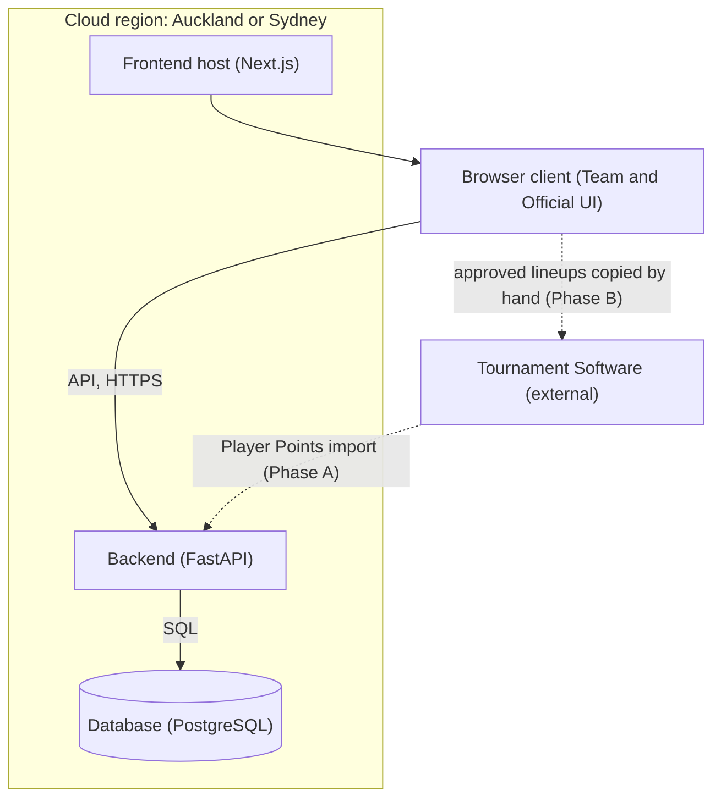
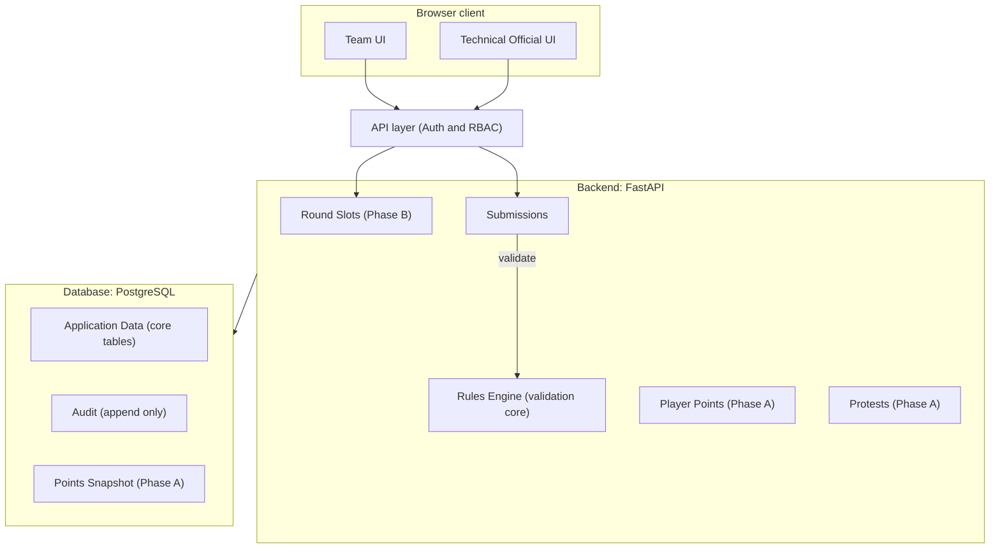
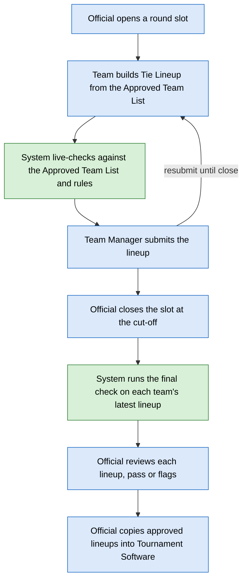
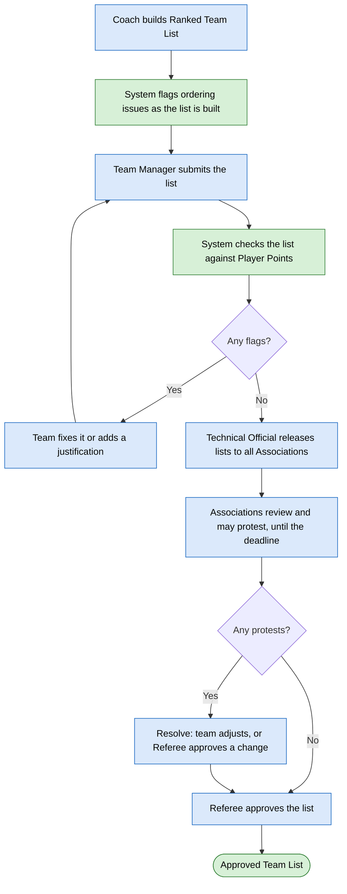
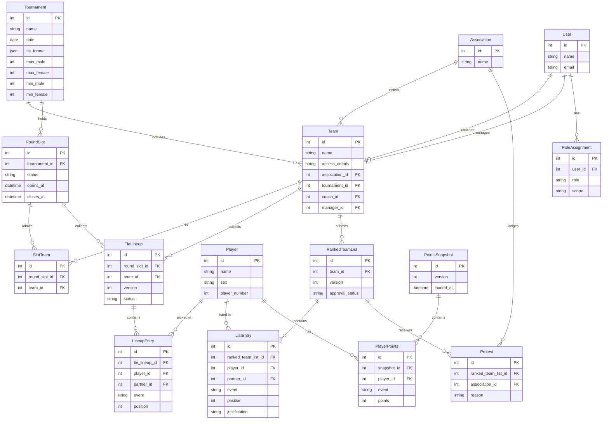
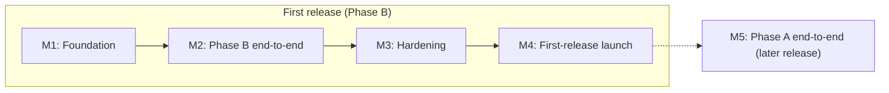

# Badminton New Zealand Team Events: Technical Planning

This document consolidates the three technical planning documents: the Solution Outline, the Technical Design, and the Implementation Plan. It is organised by theme rather than by source document, because the three overlap heavily, keeping every fact once, in the section whose job it is to own it.

The system is delivered in two phases. **Phase B, the in-tournament Tie Lineup check, is the first release.** **Phase A, the pre-tournament Ranked Team List flow, is a later release.** Phase A content is retained here, marked as such, so this document still serves when Phase A is built.

Author: Vincent Tao.

## Versioning

| Date | Author | Rationale |
| --- | --- | --- |
| 23 September 2026 | Vincent Tao | Solution Outline initial draft. |
| 28 September 2026 | Vincent Tao | Technical Design and Implementation initial drafts. |
| 24 October 2026 | Vincent Tao | Rescoped around the Phase B first release: round slots, access details, the seed, no matchup or Tie Sheet, no substitutions, manual copy into Tournament Software, and resequenced milestones. |

---

## Technology Stack

| Area | Technology | Reason |
| --- | --- | --- |
| Frontend | TypeScript, React, Next.js | Type safety for a data-heavy UI, with routing and form support. |
| Backend | Python, FastAPI | Strong request validation, readable business logic, and async support. |
| Database | PostgreSQL | Relational data model, strong integrity, transactions, and auditability. |

Finer-grained technology choices (Pydantic, SQLModel, Alembic, TanStack Query, the OpenAPI-generated client) appear in the sections that use them.

## System Architecture

Tournament Software stays external and is not integrated with: in Phase A it is the source of Player Points, and in Phase B officials copy approved lineups into it by hand.



- **Frontend:** Next.js application providing the browser-based user interface.
- **Backend:** FastAPI application providing the central API and business logic.
- **Database:** PostgreSQL as the primary application data store.
- **Tournament Software:** external; the Player Points source (Phase A) and the manual-copy destination (Phase B). No API or integration point.
- **Deployment:** a single cloud region, chosen for data residency, with automated database backups.

## System Design

The backend is organised around a shared rules engine. Round slots and submissions are the core Phase B modules; Player Points and protests belong to Phase A.



### Major Components

- **Rules Engine (shared):** the pure validation core for the live and official checks. The Phase B rules check a lineup against the Approved Team List (on the list, one Match per Event, relative order). The Phase A rules check a Ranked Team List against Player Points. The rules are in [rules.md](rules.md).
- **Round Slots (Phase B):** the submission windows an official opens and closes, with an official-set cut-off they can extend or reopen, and the teams allowed to submit into them.
- **Submissions (shared):** drafts, immutable submitted versions, status, and approval, for both Tie Lineups and Ranked Team Lists.
- **Audit (shared):** records significant business actions, append-only.
- **Player Points (Phase A):** imports Player Points from Tournament Software and maintains versioned snapshots.
- **Protests (Phase A):** releases submitted lists to associations and records protests lodged and resolved.

### Data Flows

- **Submission:** Browser → API → authorisation → rules engine → database transaction → immutable version and audit record.
- **Player Points (Phase A):** Tournament Software → import → versioned snapshot → rules engine.

## Future-State Workflows

These are the target workflows the system implements, replacing the manual current-state process in [non-technical.md](non-technical.md#current-state-workflow). Phase B is the first release and is shown first. In both diagrams, green nodes are automatic (performed by the system) and blue nodes are manual (performed by a person).

### Phase B: Tie Lineup (first release)



Officials can extend a slot's cut-off or reopen it for specific teams when a Tie runs late; these exception paths are not shown in the main flow.

### Phase A: Ranked Team List (later release)

The dashed endpoint is the Approved Team List, which becomes the reference for Phase B.



## Major Technical Decisions

- **No matchup stored.** The system never records which Team plays which. Each lineup is checked against its own Team's Approved Team List, which keeps the system complementary to Tournament Software. There is no Tie entity and no Tie Sheet.
- **Round slot as the submission window.** Submissions are gated by a slot an official opens and closes, with an official-set cut-off they can extend or reopen for specific teams, rather than fixed deadlines, because the draw is not known far ahead and Ties can overrun.
- **Access details for team login.** Teams authenticate with access details scoped to their own team and submissions; officials and associations use accounts.
- **Phased delivery, Phase B first.** Teams, access details, and Approved Team Lists are seeded for the first release; Phase A later produces the same data against the same model, so nothing in the Phase B flow changes when Phase A arrives.
- **Shared Rules Engine.** One pure rules engine powers both live and official validation, so users see the same rules while building as at the official check. The rules it enforces are listed as testable statements in [rules.md](rules.md).
- **Immutable Submission History.** Submitted records are preserved as immutable versions rather than overwritten; the latest is in effect, and earlier ones are superseded.
- **Transactional Writes.** State changes and their audit records commit in the same database transaction.
- **Server-Side Authorisation.** Role-based access control and team or association scope are enforced by the backend, not the frontend.
- **Versioned Player Points (Phase A).** Player Points are stored as frozen, versioned snapshots, so validation uses a reproducible dataset rather than changing external data.

## Database Design

### Entity Relationship Diagram

> **This ERD is a guideline, not a strict ruleset.** The schema is expected to change as the build progresses. Changes are normal and should be flagged to and confirmed with the project owner when they happen. The authoritative schema is the SQLModel models and the Alembic migrations.



### Notes and simplifications to confirm

The attribute types above are indicative; the concrete types (including whether identifiers are integer or UUID) are decided in the SQLModel models and the migration.

- **No matchup is stored.** There is no Tie entity: the Round Slot is the submission window, and a Tie Lineup belongs to a Round Slot and a Team. A Round Slot can be limited to specific teams through SlotTeam, which backs the selective-gating stories (US-41, US-42) and ships with the Phase A release; the Must-Have Phase B base opens a slot to all playing teams.
- **A list or lineup's ordered contents are rows.** ListEntry and LineupEntry hold the players and pairs at each event and position; a `partner_id` marks a Doubles or Mixed pair (null for Singles). `justification` on ListEntry records a Doubles or Mixed deviation (Phase A).
- **An event is one of five disciplines:** Men's Singles, Women's Singles, Men's Doubles, Women's Doubles, and Mixed Doubles. `Tournament.tie_format` is structured (a count of Matches per event, in any combination) rather than a plain string, and a Tie Lineup fills one entry per (event, position) slot the format defines.
- **Team composition is Phase A.** `Player.sex`, the optional `Tournament.min_male`, `max_male`, `min_female` and `max_female` limits, and the per-event `PlayerPoints.event` support the roster rules built in Phase A (a player is listed only in events for their sex, a Mixed pair is one male and one female, and the roster respects the tournament's male and female limits; see [rules.md](rules.md)). Phase B inherits correct entries from the Approved Team List and does not check sex.
- **Approved Team List is a state,** represented by `approval_status` on RankedTeamList, not a separate entity. In the first release it is seeded as approved; in Phase A the approval flow sets it.
- **`version` is an attribute** on submittable records (RankedTeamList and TieLineup). Each submission is a new row; immutability is delivered by writing a new row per submission, not by mutating this field. The latest is in effect and earlier ones are superseded.
- **Each team has at most one coach and one manager**, so those relationships are one-to-one.
- **Player Points use two tables (Phase A).** PointsSnapshot is one row per import; PlayerPoints is one row per player per event within a snapshot, ideally with a unique constraint on (`snapshot_id`, `player_id`, `event`). How the current snapshot is identified (highest `version`, or an `is_current` flag) is still open.
- **RoleAssignment carries a `scope`** (for example an association, team, or tournament) so roles such as an association reviewer or a tournament official can be expressed.
- **The audit log is intentionally omitted** from the ERD because it references many entities. It is described under Security Implementation, Audit Logging.
- **Out of scope:** there is no Tie, Tie Sheet, or Substitution entity; those are handled in Tournament Software or by officials.

## API Design

- REST over HTTPS using FastAPI, served under a `/v1` prefix.
- A draft is autosaved, live checks do not persist changes, and submission creates an immutable version and performs the official validation.
- In Phase B, a lineup can be submitted only while its round slot is open; a closed slot rejects further submissions.

### Endpoints

#### Authentication

| Method | Endpoint | Purpose |
| --- | --- | --- |
| POST | `/v1/auth/login` | Sign in (account or team access details) |
| POST | `/v1/auth/logout` | Sign out |
| POST | `/v1/auth/recover` | Request account recovery |
| POST | `/v1/auth/reset` | Reset account password |

#### Tournament and Setup

| Method | Endpoint | Purpose |
| --- | --- | --- |
| GET, POST | `/v1/tournaments` | List and create tournaments |
| GET, PATCH | `/v1/tournaments/{id}` | View and update a tournament |
| GET | `/v1/tournaments/{id}/dashboard` | Tournament dashboard |
| CRUD | `/v1/associations` | Manage associations |
| CRUD | `/v1/teams` | Manage teams |
| POST | `/v1/teams/{id}/access-details` | Issue or reissue team access details |
| POST | `/v1/teams/{id}/approved-list` | Seed an Approved Team List (first release) |
| CRUD | `/v1/users` | Manage users |
| CRUD | `/v1/role-assignments` | Manage role assignments |
| GET | `/v1/players` | Retrieve players |

#### Phase B: Round Slots and Tie Lineup

| Method | Endpoint | Purpose |
| --- | --- | --- |
| GET, POST | `/v1/tournaments/{id}/slots` | List and open round slots |
| PATCH | `/v1/slots/{id}` | Close, reopen, or extend a slot |
| PUT | `/v1/slots/{id}/teams` | Set which teams may submit |
| GET, PUT | `/v1/tie-lineups/{id}/draft` | Retrieve and update draft |
| POST | `/v1/tie-lineups/{id}/check` | Run live validation |
| POST | `/v1/tie-lineups/{id}/submit` | Submit and run official validation |
| POST | `/v1/tie-lineups/{id}/approve` | Approve lineup |
| POST | `/v1/tie-lineups/{id}/mark-copied` | Mark as copied into Tournament Software |

#### Phase A: Ranked Team List

| Method | Endpoint | Purpose |
| --- | --- | --- |
| GET, PUT | `/v1/ranked-team-lists/{id}/draft` | Retrieve and update draft |
| POST | `/v1/ranked-team-lists/{id}/check` | Run live validation |
| POST | `/v1/ranked-team-lists/{id}/submit` | Submit and run official validation |
| POST | `/v1/ranked-team-lists/{id}/release` | Release the submitted list |
| POST | `/v1/ranked-team-lists/{id}/approve` | Approve list |
| POST | `/v1/ranked-team-lists/{id}/protests` | Lodge protest |
| POST | `/v1/protests/{id}/resolve` | Resolve protest |

#### Phase A: Player Points

| Method | Endpoint | Purpose |
| --- | --- | --- |
| POST | `/v1/points/snapshots` | Load Player Points |
| GET | `/v1/points/snapshots/{id}` | Retrieve a snapshot |

#### Other

| Method | Endpoint | Purpose |
| --- | --- | --- |
| GET | `/v1/tournaments/{id}/audit` | Retrieve audit history |
| WS | `/v1/tournaments/{id}/stream` | Real-time status updates |

### Request and Response Models

- All request and response bodies use typed Pydantic models.
- The frontend client is generated from the FastAPI OpenAPI schema, so request and response models are the public API contract.

### Validation Results

Live checks and official checks use one shared validation-result structure. Findings identify the affected location, the rule, and the corrective action.

Passing check:

```json
{ "ok": true, "findings": [] }
```

Failing check (a Phase B example):

```json
{
  "ok": false,
  "findings": [
    {
      "severity": "block",
      "location": { "event": "mens_singles", "position": 2 },
      "rule": "Relative order within an Event must be preserved",
      "message": "Position 2 is above position 1 on the Approved Team List",
      "how_to_fix": "Swap positions 1 and 2"
    }
  ]
}
```

### Error Handling

- The API uses a consistent error response format and standard HTTP status codes.
- Domain validation failures are returned as structured validation results rather than API errors.
- Submission conflicts and submissions to a closed slot return `409 Conflict`.
- Submissions carry an idempotency key, so a retry after an unclear result returns the original outcome rather than creating a second version.

## Frontend Architecture

### Routes

The application uses the Next.js App Router with role-protected routes.

| Area | Route |
| --- | --- |
| Authentication | `/login`, `/recover`, `/reset` |
| Tournament, Dashboard | `/tournaments`, `/tournaments/[id]` |
| Round Slots (Phase B) | `/tournaments/[id]/slots` |
| Tie Lineup (Phase B) | `/tournaments/[id]/slots/[slotId]/lineup/[teamId]` |
| Review and Handoff (Phase B) | `/tournaments/[id]/slots/[slotId]` |
| Ranked Team List (Phase A) | `/tournaments/[id]/lists/[teamId]` |
| Review and Protest (Phase A) | `/tournaments/[id]/lists` |
| Administration | `/admin` |

### Component Structure

The frontend is organised into feature modules: Tournaments, Round Slots, Tie Lineups, Ranked Team Lists (Phase A), Protests (Phase A), and Administration. The Ranked Team List and Tie Lineup builders share reusable components for position editing, validation findings, and submission status.

### State Management

- **Server state:** TanStack Query for API data, caching, and refetching.
- **Local state:** React state for builder interactions.
- **Draft persistence:** drafts autosave to the backend and are mirrored locally to reduce data loss during connection interruptions.
- **Authentication state:** derived from the server-side session cookie.

### API Integration

- A typed client is generated from the FastAPI OpenAPI schema.
- All reads and mutations use the generated client through TanStack Query.
- Live validation is triggered with a debounced request as the user edits a list or lineup.

## Security Implementation

See [conventions.md](conventions.md) for how these are applied at the code level.

### Authentication

- Email and password for officials and associations; teams sign in with access details scoped to their team.
- Passwords and access details are stored using a strong hash such as Argon2id.
- Sessions are stored in httpOnly, Secure, SameSite cookies.
- Account recovery uses time-limited links; team access details are reissued by an official.
- All traffic uses HTTPS and TLS.

### Authorisation

- RBAC with team, association, and tournament scoping.
- Enforced server-side on every protected request.
- Administrative overrides are recorded in the audit log.
- The audit log is append-only, so records cannot be altered after the fact.

### Audit Logging

The audit log records significant business actions rather than individual API requests. The following are recorded:

- **Submission:** a Ranked Team List or Tie Lineup is submitted, with who submitted it.
- **Round Slot:** a slot is opened, closed, reopened, or extended, with who did it.
- **Approval:** a Ranked Team List or Tie Lineup is approved, with who approved it.
- **Copy to Tournament Software:** an approved lineup is marked copied, with who copied it.
- **Release (Phase A):** a Ranked Team List is released to associations.
- **Protest (Phase A):** a protest is lodged or resolved, with the responsible user.
- **Player Points (Phase A):** a snapshot is loaded and identified when it becomes the current one.
- **Administrative Override:** an override or step-in is performed, with the administrator.
- **Access Changes:** accounts, access details, and role assignments are created, modified, or removed, with who made the change.

Audit records include the actor, action, affected entity, timestamp, and relevant context, and are written in the same transaction as the state change where applicable.

### Validation

Validation occurs at two levels:

- **Request validation:** Pydantic validates request structure and types.
- **Domain validation:** the rules engine validates business rules, against the Approved Team List in Phase B and against the Player Points snapshot in Phase A.

No client-side validation is trusted as a security boundary.

### API Data Security

- Secrets stored outside the source code.
- Least-privilege database credentials.
- Parameterised database queries through the ORM.
- CSRF protection for cookie-based authentication.
- Rate limiting on authentication endpoints.
- Minimal collection and storage of player data.
- Dependencies regularly scanned for known vulnerabilities.
- Player data is stored in a New Zealand or Australian region, to meet NZ Privacy Act 2020 residency requirements.

## Deployment

### Environments

Local → Staging → Production.

- **Local:** Docker Compose provides the local web application, API, and PostgreSQL services.
- **Staging:** used for integration testing and testing with officials before tournaments.
- **Production:** hosts the application and database in the selected cloud region.

### CI/CD

The deployment pipeline runs automated tests, runs linting and type checks, builds the application, takes a database backup, applies database migrations, and deploys to the target environment.

## Monitoring and Reliability

- **Monitoring:** application health endpoint, platform and infrastructure metrics, error monitoring and alerts, and structured application logs, watched during tournament operation.
- **Backups:** automated database backups, point-in-time recovery, and periodic restore testing.
- **Failure handling:** a manual process is maintained as a fallback if the system becomes unavailable during a tournament.

## Testing

- **Unit:** the rules engine receives comprehensive unit tests covering the individual Phase B and Phase A domain rules and edge cases.
- **Integration:** API endpoints, database operations, authentication and authorisation, submission and versioning workflows, and Player Points ingestion (Phase A).
- **End-to-end:** Phase B, a Tie Lineup from an open round slot through submission, checking, review, and copy; Phase A (later), a Ranked Team List from draft to approval, and the protest workflow.
- **User acceptance:** the complete system is tested with tournament officials in staging before production.

## Delivery Plan

Development is dependency-ordered so the core domain logic is established before the UI is built around it. The first release delivers Phase B through to production; Phase A follows as a later release.



### Milestones

| Milestone | Deliverable |
| --- | --- |
| M1: Foundation | Repositories, local database, CI, schema and migrations, the Phase B rules engine, tournament setup, sign-in with access details, and the first-release seed of teams, access details, and Approved Team Lists. |
| M2: Phase B end-to-end | Round slots (open, close, reopen, extend, and selective teams), Tie Lineup building, live and final checks, submission, and the official review and copy into Tournament Software, plus the shared builder and usability foundation. |
| M3: Hardening | Security, testing, monitoring, reliability, backups, and staging testing. |
| M4: First-release launch | Production deployment, final user acceptance testing, and the manual fallback. This launches the Phase B first release. |
| M5: Phase A end-to-end (later release) | Player Points, Ranked Team List building, live checks, submission, release, protest, and approval, replacing the seed. Reuses the hardening and deployment pipeline from M3 and M4. |

### External Dependencies

These sit outside the core application build and may affect implementation decisions and milestone completion:

- **Player Points format:** confirm how Player Points are provided by Tournament Software (CSV, file export, or API). Determines the ingestion approach for Phase A (M5).
- **UI and UX validation:** a light review of the Tie Lineup builder before M2, and of the Ranked Team List builder before M5.
- **Account provisioning:** confirm whether Badminton NZ creates accounts or associations self-register. Determines the account and access model for Phase A (M5); the first release seeds team access directly.
- **Data residency:** confirm whether player data must be stored in New Zealand. Determines the cloud region and deployment configuration for M4.
